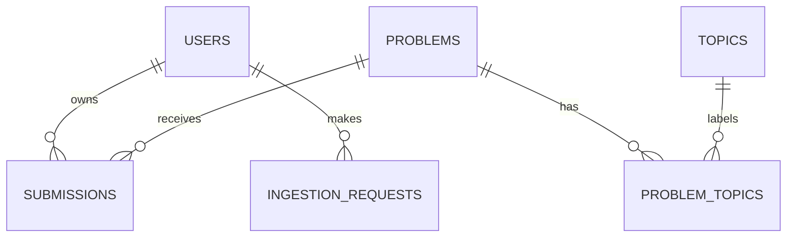

# Phase 2: backend foundation

## What we built

The API can start, validate configuration, connect to PostgreSQL, and report its health.
Alembic creates the initial relational schema. Tests verify the actual PostgreSQL behavior.
This is a backend foundation, not yet a submission-entry product.

## File map and reading order

| File | Responsibility |
|---|---|
| `backend/pyproject.toml` | Project metadata, dependencies, test/lint configuration |
| `backend/requirements.lock` | Exact tested dependency versions |
| `.env.example` | Documented configuration template without real credentials |
| `compose.yaml` | Local PostgreSQL 17, health check, persistent volume |
| `backend/app/config.py` | Validates settings and keeps the connection URL secret in representations |
| `backend/app/main.py` | App factory, startup/shutdown lifecycle, route registration |
| `backend/app/db.py` | Connection pool, session factory, per-request session dependency |
| `backend/app/models/base.py` | UUID IDs, timestamps, named constraints, UTC timestamp type |
| `backend/app/models/tracking.py` | Six initial tables and ORM relationships |
| `backend/app/api/health.py` | Typed health responses and safe database failure reporting |
| `backend/migrations/env.py` | Connects Alembic to settings and model metadata |
| `backend/migrations/versions/0001_initial_tracking_foundation.py` | Frozen initial schema and rollback |
| `backend/tests/` | Unit tests and real PostgreSQL integration tests |

## Follow one request

1. Uvicorn creates the FastAPI app using `create_app()`.
2. Pydantic validates configuration before the application accepts traffic.
3. FastAPI's lifespan creates an engine and session factory, then disposes the engine on shutdown.
4. `GET /api/v1/health/ready` acquires a connection from the pool.
5. SQLAlchemy runs a connectivity query and reads the Alembic revision.
6. FastAPI validates and serializes the response using its Pydantic response model.

The engine opens database connections lazily. The API can therefore still expose liveness
when PostgreSQL is down. Its synchronous health handler runs outside the async event loop,
so synchronous database calls do not block that loop.

A connection pool reuses connections instead of authenticating a new connection for every
request. This is common in database-backed web services. `pool_pre_ping` detects stale
connections; connect, pool, and statement timeouts bound common failures. They do not
substitute for an overall request timeout in a later deployment configuration.

## Models, schemas, and migrations are different

- A **SQLAlchemy model** describes persisted records and relationships.
- A **Pydantic schema** describes validated application input/output. Here these are settings
  and health responses; submission request schemas arrive in Phase 3.
- An **Alembic migration** describes how to change the actual database structure.

Changing a Python model does not change PostgreSQL. We never call `create_all()` at startup.
The checked-in migration uses fixed SQLAlchemy types and does not import mutable application
models, so later model edits cannot change the meaning of this migration.

Useful migration commands from the repository root:

```bash
alembic -c backend/alembic.ini current
alembic -c backend/alembic.ini history
alembic -c backend/alembic.ini upgrade head
alembic -c backend/alembic.ini check
```

In a later approved phase, change models, generate a new revision with `revision
--autogenerate -m 'describe change'`, inspect it, and then upgrade. Autogeneration is a draft:
it does not reliably infer renames or all check-constraint changes. Do not edit an old
migration once other environments rely on it. Downgrades can remove data; this phase's
round-trip downgrade test runs only in an isolated disposable schema.

## Initial relationships



`users` stores profile information, the reporting timezone, tracking start date, and whether
history is complete. Creating users and owner authentication are not exposed yet. The
`DEFAULT_TIMEZONE` configuration reserves the initial user preference for that future flow;
the model currently defaults to Asia/Kolkata. The tracking start date must be explicit.

`problems` stores minimal metadata. `(platform, slug)` identifies a problem. `topics` and
`problem_topics` allow several topic labels per problem without comma-separated text.

`submissions` stores events, not a single row per solved problem. Two accepted events for
the same problem are allowed when their record identities differ. The future service can
then distinguish two accepted submissions from one unique solve.

`ingestion_requests` stores a request key, a SHA-256 payload hash, and an optional completed
result. The unique key is infrastructure for Phase 3 idempotency, not an implemented retry
workflow. Completion time and result must both be present or both absent.

Database constraints are the final defense when two requests arrive at once. An application
check alone can race: both requests may see "no existing row" before either inserts.
This is why production systems use unique constraints in addition to friendly validation.

## Timestamps and unknown facts

Event timestamps use `timestamptz`; the application uses UTC sessions and normalizes values
to UTC. A naive timestamp is rejected by the ORM type. The original timezone name is not
stored with each instant; the user's timezone controls later reporting.

For example, `2026-11-10T00:15:00+05:30` is stored/read as the same instant as
`2026-11-09T18:45:00Z`. The integration test verifies this boundary.

Unknown difficulty and submission time are nullable. No independence classification is
inferred from acceptance. Assessments, goal policies, and analytics are later-phase tables.

UUIDs are generated by Python when ORM records are inserted. `created_at` defaults in
PostgreSQL. `updated_at` is refreshed by SQLAlchemy updates; direct SQL callers must update
it explicitly. Direct SQL also bypasses Python timezone validation, so future public writes
must go through validated application paths.

## Sessions and transactions

`get_session()` provides a request-scoped session. A future write service must explicitly
call `commit()` after completing its work. Closing the session rolls back uncommitted work.
It never silently commits at the end of a request.

A **transaction** groups related writes into one success or failure. Phase 3 will insert
the request identity and submission in one transaction, preventing half-written operations.
The same pattern is used for orders, payments, and inventory changes.

## Debugging common failures

| Symptom | What to inspect |
|---|---|
| Missing/invalid settings error | Root `.env`, URL driver prefix, and environment overrides |
| Port already in use | Change `POSTGRES_PORT` and URL port together; this workspace uses 55432 |
| Readiness says database unavailable | `docker compose ps`, `docker compose logs --tail=50 db`, credentials and port |
| Database reachable but schema unavailable/not current | Run `alembic -c backend/alembic.ini upgrade head` |
| Password fails after editing `.env` | Existing volume retains its original password; updating `.env` alone cannot rotate it |
| `ModuleNotFoundError: app` | Activate `.venv` and install the backend in editable mode |
| Integration tests skipped | Configure `TEST_DATABASE_URL`; use `--require-postgres` for complete verification |
| Test database does not exist | Run the one-time `createdb` command in the README |
| Timestamp rejected | Include `Z` or a numeric offset instead of a naive datetime |
| Duplicate constraint violation | Inspect the named constraint and record identity; do not remove the constraint |
| Docker socket permission denied | Ensure your local Docker installation grants your user access |

Runtime readiness failures log the exception class without credentials, SQL parameters, or
raw driver errors. For learning/debugging, use migration output and PostgreSQL logs locally;
do not post connection strings or `.env` contents publicly.

## Verification and stopping point

Verified locally on November 10, 2026, using Python 3.10 and PostgreSQL 17:

- Full suite: **34 passed** (11 unit tests and 23 PostgreSQL integration cases), no warnings.
- Ruff lint and formatting: passed.
- `pip check`: no broken requirements.
- `alembic check`: no new upgrade operations detected.
- Live HTTP demonstration: liveness, readiness, and Swagger UI all returned HTTP 200.

The suite covers configuration validation/redaction, both health failure modes, migrations,
database relationships, identity constraints, unknown metadata, UTC handling, and ingestion
request state. Test schemas are built with migrations rather than model-driven `create_all()`.

- [x] FastAPI app factory and interactive API documentation
- [x] PostgreSQL connection pool and session lifecycle
- [x] Six initial tables with foreign keys, constraints, and indexes
- [x] Alembic initial migration and schema drift check
- [x] Unit and real PostgreSQL integration tests
- [x] Local setup, demonstration, and troubleshooting instructions
- [ ] Phase 3: submission-entry behavior — intentionally awaiting a later session

You have practiced configuration, REST health endpoints, relational modeling, transactions,
database migrations, and integration testing. Phase 2 ends here.

References: [FastAPI lifespan](https://fastapi.tiangolo.com/advanced/events/),
[SQLAlchemy engine configuration](https://docs.sqlalchemy.org/en/20/core/engines.html),
[Alembic tutorial](https://alembic.sqlalchemy.org/en/latest/tutorial.html).
